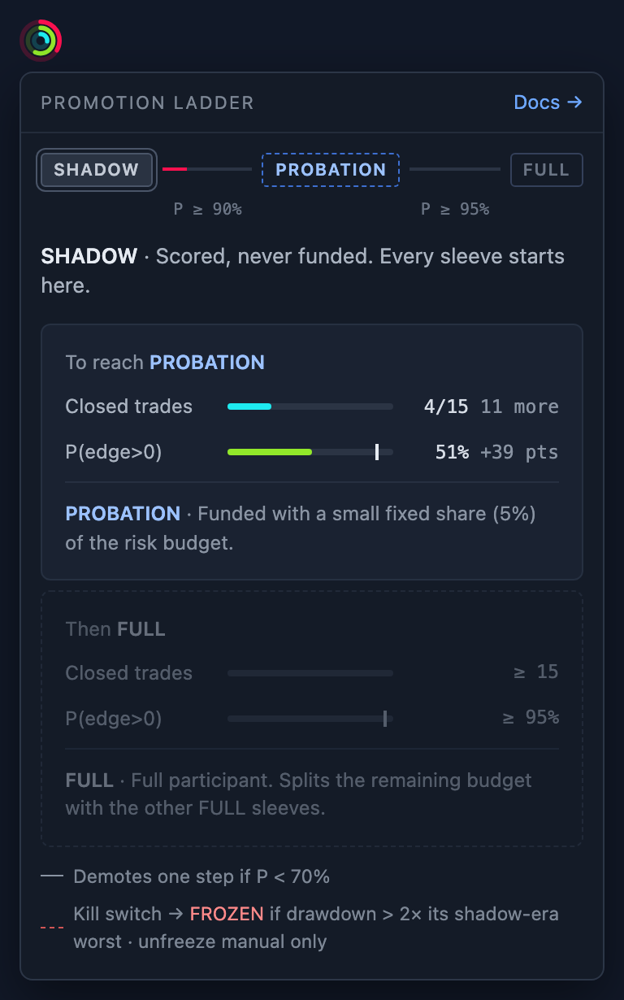
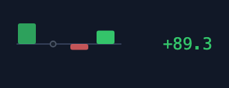
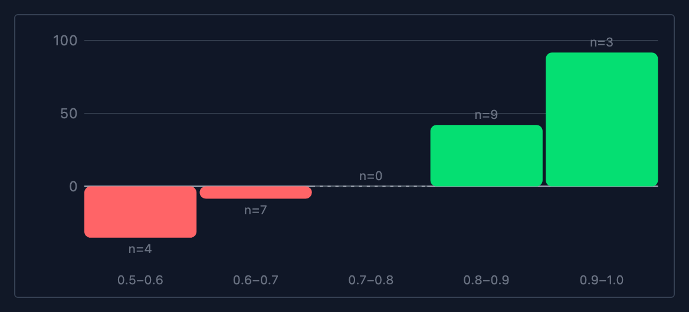

# trajder-ui

[](https://hirro.github.io/trajder-ui/) [](LICENSE)

Svelte 5 components and helpers shared by Trajder and trajder-ai: the promotion ladder badge, sleeve scorecard formatting and sorting, weekly result bars, the calibration chart and the sparklines.

## Components

Every component's states, props and code are in the [live catalogue](https://hirro.github.io/trajder-ui/).

| Component | |
| --- | --- |
| **[LadderBadge](https://hirro.github.io/trajder-ui/?path=/docs/sleeves-ladderbadge--docs)**<br>A sleeve's rung on the promotion ladder as three rings. Hover for the card that steps through the ladder. |  |
| **[WeeklyResultBars](https://hirro.github.io/trajder-ui/?path=/docs/sleeves-weeklyresultbars--docs)**<br>Net realized bps for each of the last four weeks, and their total. |  |
| **[SleeveCalibrationChart](https://hirro.github.io/trajder-ui/?path=/docs/sleeves-sleevecalibrationchart--docs)**<br>Mean excess return per conviction bucket. |  |
| **[IndicatorSparkline](https://hirro.github.io/trajder-ui/?path=/docs/charts-indicatorsparkline--docs)**<br>A price line with a crosshair tooltip, an optional index to compare against, and event markers. |  |
| **[Sparkline](https://hirro.github.io/trajder-ui/?path=/docs/charts-sparkline--docs)**<br>A small line for a series of numbers. |  |
| **[ScoreRing](https://hirro.github.io/trajder-ui/?path=/docs/charts-scorering--docs)**<br>A 0–100 score as a ring. |  |

The helpers behind them are exported too: the scorecard formatting in `sleeveFormat` (`fmtPct`, `pPositive`, `ladderView`, `weeklyBars`, …), `sortSleeves`, the sparkline and calibration-chart geometry, and the payload types.

## Use

```sh
npm install github:hirro/trajder-ui#v0.1.0
```

```ts
import { LadderBadge, fmtPct, sortSleeves } from "trajder-ui";
```

The package ships its Svelte and TypeScript source, and the app's Vite build compiles it. The app sets up two things:

- Tailwind skips `node_modules`, so point it at the components in the app's CSS, after `@import "tailwindcss";`:

  ```css
  @source "../node_modules/trajder-ui/src";
  ```

- The ladder card's docs link (hidden until set) and the rung texts belong to the app. Set them once before mounting:

  ```ts
  import { LADDER_DOCS } from "trajder-ui";
  Object.assign(LADDER_DOCS, { href: "#/doc/sleeves/LIFECYCLE.md", label: "Lifecycle docs →" });
  ```

## Develop

```sh
npm install
npm run check
npm test
npm run storybook   # the catalogue on http://localhost:6006
```

Pushing to `main` publishes the catalogue to GitHub Pages.

To release, tag `vX.Y.Z`, push the tag, then bump `#vX.Y.Z` in each app's `package.json` and run `npm install`.
